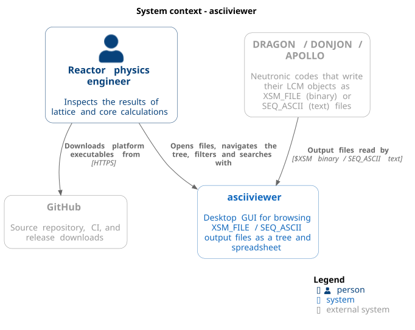
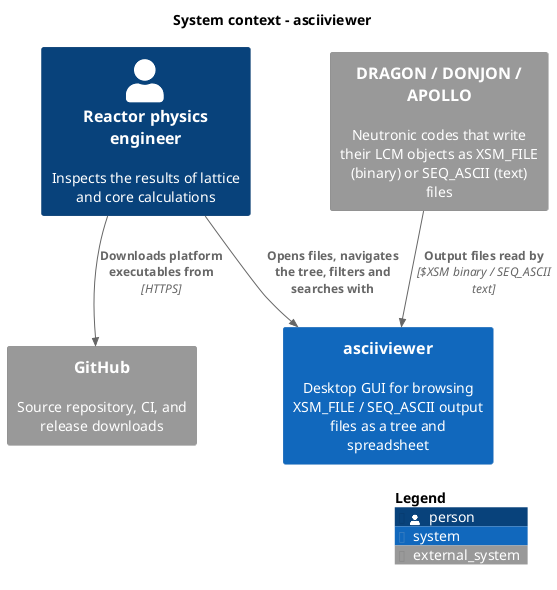
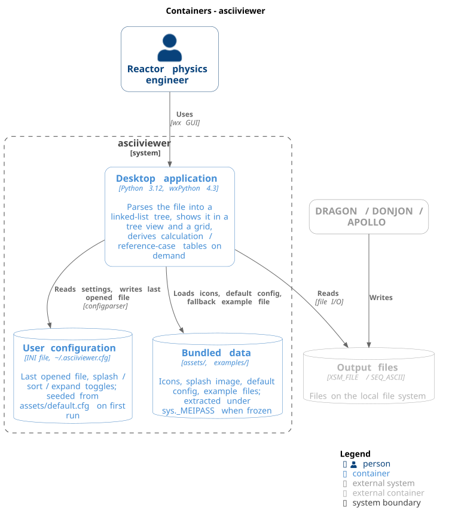
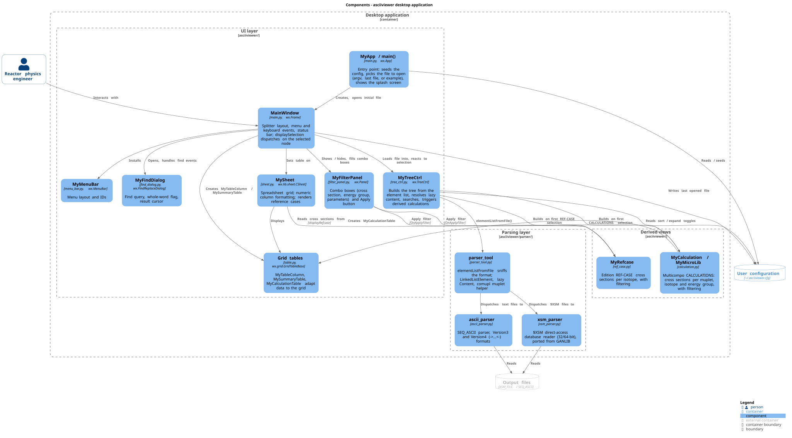
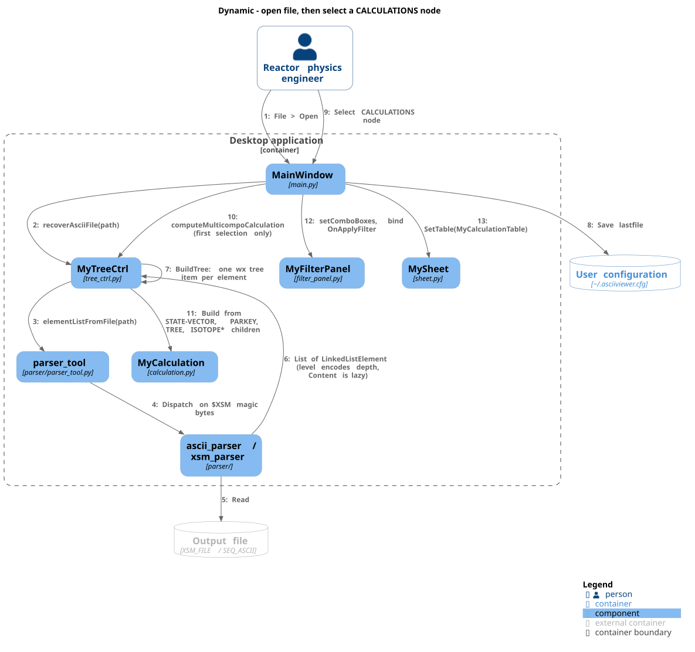
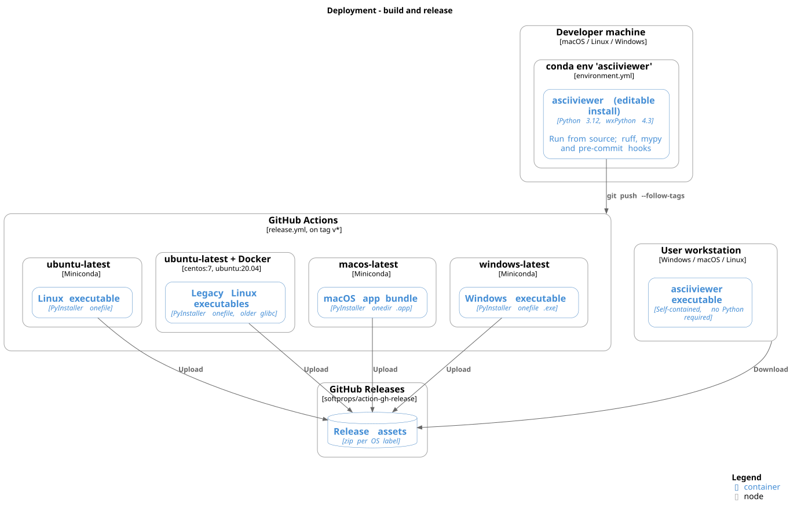
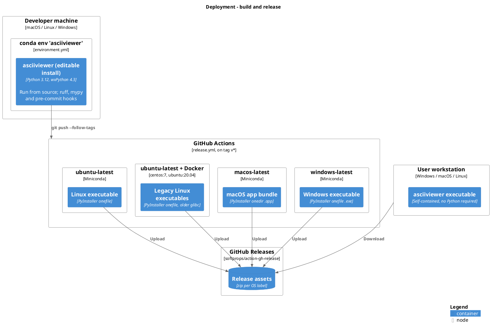

# Architecture

C4 model of __asciiviewer__, written with [C4-PlantUML](https://github.com/plantuml-stdlib/C4-PlantUML). The diagrams
include the C4 macros from the PlantUML standard library (`!include <C4/...>`), so they render offline with any
recent PlantUML. `make diagrams` renders them to `docs/diagrams/*.svg` with the official PlantUML Docker image
(started through colima), so no local Java or PlantUML install is needed; re-run it after editing a diagram.

## Level 1 - System context

The app is a standalone desktop viewer: it has no network dependencies at runtime. Its only inputs are the
output files the neutronic codes write.

PlantUML source

## Level 2 - Containers

A single process (the wxPython app, run from source or as a PyInstaller bundle) plus the files it reads and
writes on the local file system.

```plantuml
@startuml containers
!NEW_C4_STYLE=1
!include <C4/C4_Container>

title Containers - asciiviewer

Person(engineer, "Reactor physics engineer")
System_Ext(codes, "DRAGON / DONJON / APOLLO")

System_Boundary(sys, "asciiviewer") {
    Container(app, "Desktop application", "Python 3.12, wxPython 4.3", "Parses the file into a linked-list tree, shows it in a tree view and a grid, derives calculation / reference-case tables on demand")
    ContainerDb(config, "User configuration", "INI file, &#126;/.asciiviewer.cfg", "Last opened file, splash / sort / expand toggles; seeded from assets/default.cfg on first run")
    ContainerDb(bundled, "Bundled data", "assets/, examples/", "Icons, splash image, default config, example files; extracted under sys._MEIPASS when frozen")
}

ContainerDb_Ext(datafiles, "Output files", "XSM_FILE / SEQ_ASCII", "Files on the local file system")

Rel(codes, datafiles, "Writes")
Rel(engineer, app, "Uses", "wx GUI")
Rel(app, datafiles, "Reads", "file I/O")
Rel(app, config, "Reads settings, writes last opened file", "configparser")
Rel(app, bundled, "Loads icons, default config, fallback example file")

SHOW_LEGEND()
@enduml
```

PlantUML source

## Level 3 - Components of the desktop application

The UI layer lives in `asciiviewer/*.py`, the parsing layer in `asciiviewer/parser/`. `MainWindow.displaySelection`
is the central dispatch that decides what the right-hand panel shows for the selected tree node.

```plantuml
@startuml components
!NEW_C4_STYLE=1
!include <C4/C4_Component>

title Components - asciiviewer desktop application

Person(engineer, "Reactor physics engineer")
ContainerDb_Ext(datafiles, "Output files", "XSM_FILE / SEQ_ASCII")
ContainerDb(config, "User configuration", "&#126;/.asciiviewer.cfg")

Container_Boundary(app, "Desktop application") {

    Boundary(ui, "UI layer", "asciiviewer/") {
        Component(appmain, "MyApp / main()", "main.py, wx.App", "Entry point: seeds the config, picks the file to open (argv, last file, or example), shows the splash screen")
        Component(window, "MainWindow", "main.py, wx.Frame", "Splitter layout, menu and keyboard events, status bar; displaySelection dispatches on the selected node")
        Component(menu, "MyMenuBar", "menu_bar.py, wx.MenuBar", "Menu layout and IDs")
        Component(find, "MyFindDialog", "find_dialog.py, wx.FindReplaceDialog", "Find query, whole-word flag, result cursor")
        Component(tree, "MyTreeCtrl", "tree_ctrl.py, wx.TreeCtrl", "Builds the tree from the element list, resolves lazy content, searches, triggers derived calculations")
        Component(filter, "MyFilterPanel", "filter_panel.py, wx.Panel", "Combo boxes (cross section, energy group, parameters) and Apply button")
        Component(sheet, "MySheet", "sheet.py, wx.lib.sheet.CSheet", "Spreadsheet grid; numeric column formatting; renders reference cases")
        Component(tables, "Grid tables", "table.py, wx.grid.GridTableBase", "MyTableColumn, MySummaryTable, MyCalculationTable adapt data to the grid")
    }

    Boundary(domain, "Derived views", "asciiviewer/") {
        Component(calc, "MyCalculation / MyMicroLib", "calculation.py", "Multicompo CALCULATIONS: cross sections per muplet, isotope and energy group, with filtering")
        Component(refcase, "MyRefcase", "ref_case.py", "Edition REF-CASE cross sections per isotope, with filtering")
    }

    Boundary(parser, "Parsing layer", "asciiviewer/parser/") {
        Component(ptool, "parser_tool", "parser_tool.py", "elementListFromFile sniffs the format; LinkedListElement, lazy Content, comupl muplet helper")
        Component(ascii, "ascii_parser", "ascii_parser.py", "SEQ_ASCII parser, Version3 and Version4 (->...<-) formats")
        Component(xsm, "xsm_parser", "xsm_parser.py", "$XSM direct-access database reader (32/64-bit), ported from GANLIB")
    }
}

Rel(engineer, window, "Interacts with")
Rel(appmain, config, "Reads / seeds")
Rel(appmain, window, "Creates, opens initial file")
Rel(window, menu, "Installs")
Rel(window, find, "Opens, handles find events")
Rel(window, tree, "Loads file into, reacts to selection")
Rel(window, filter, "Shows / hides, fills combo boxes")
Rel(window, sheet, "Sets table on")
Rel(window, tables, "Creates MyTableColumn / MySummaryTable")
Rel(window, config, "Writes last opened file")

Rel(tree, config, "Reads sort / expand toggles")
Rel(tree, ptool, "elementListFromFile()")
Rel(tree, calc, "Builds on first CALCULATIONS selection")
Rel(tree, refcase, "Builds on first REF-CASE selection")

Rel(ptool, ascii, "Dispatches text files to")
Rel(ptool, xsm, "Dispatches $XSM files to")
Rel(ascii, datafiles, "Reads")
Rel(xsm, datafiles, "Reads")

Rel(calc, tables, "Creates MyCalculationTable")
Rel(filter, calc, "Apply filter", "OnApplyFilter")
Rel(filter, refcase, "Apply filter", "OnApplyFilter")
Rel(sheet, refcase, "Reads cross sections from", "displayRefcase")
Rel(sheet, tables, "Displays")

SHOW_LEGEND()
@enduml
```

PlantUML source

## Dynamic view - opening a file and selecting a node

How a file becomes a tree, and what happens when a `CALCULATIONS` node is selected for the first time (derived
views are computed lazily and cached on the node, so the second selection goes straight to display).

```plantuml
@startuml dynamic
!NEW_C4_STYLE=1
!include <C4/C4_Dynamic>

title Dynamic - open file, then select a CALCULATIONS node

Person(engineer, "Reactor physics engineer")
ContainerDb_Ext(datafiles, "Output file", "XSM_FILE / SEQ_ASCII")
ContainerDb(config, "User configuration", "&#126;/.asciiviewer.cfg")

Container_Boundary(app, "Desktop application") {
    Component(window, "MainWindow", "main.py")
    Component(tree, "MyTreeCtrl", "tree_ctrl.py")
    Component(ptool, "parser_tool", "parser/parser_tool.py")
    Component(parsers, "ascii_parser / xsm_parser", "parser/")
    Component(calc, "MyCalculation", "calculation.py")
    Component(filter, "MyFilterPanel", "filter_panel.py")
    Component(sheet, "MySheet", "sheet.py")
}

Rel(engineer, window, "File > Open")
Rel(window, tree, "recoverAsciiFile(path)")
Rel(tree, ptool, "elementListFromFile(path)")
Rel(ptool, parsers, "Dispatch on $XSM magic bytes")
Rel(parsers, datafiles, "Read")
Rel(parsers, tree, "List of LinkedListElement (level encodes depth, Content is lazy)")
Rel(tree, tree, "BuildTree: one wx tree item per element")
Rel(window, config, "Save lastfile")
Rel(engineer, window, "Select CALCULATIONS node")
Rel(window, tree, "computeMulticompoCalculation (first selection only)")
Rel(tree, calc, "Build from STATE-VECTOR, PARKEY, TREE, ISOTOPE* children")
Rel(window, filter, "setComboBoxes, bind OnApplyFilter")
Rel(window, sheet, "SetTable(MyCalculationTable)")

SHOW_LEGEND()
@enduml
```

PlantUML source

## Deployment

Pushing a `v*` tag (created by `bump2version`) runs `.github/workflows/release.yml`, which builds a PyInstaller
executable per platform and attaches them to a GitHub release.

PlantUML source

